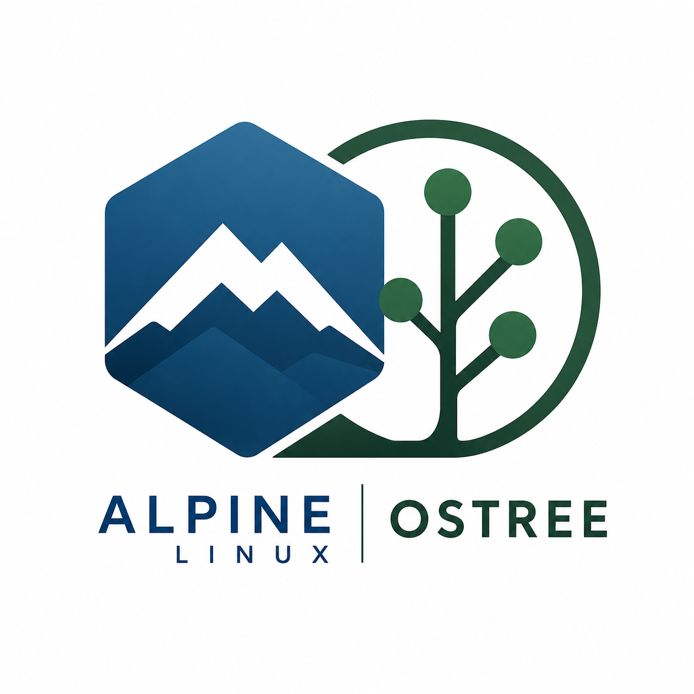

<p align="center">
  
</p>

<h1 align="center">NULIX</h1>

<p align="center">
  <strong>Alpine Linux + OSTree</strong><br/>
  Minimal, immutable, and reproducible Linux for embedded and edge systems
</p>

<p align="center">
  
  
  
  
</p>

---

## 🚀 What is NULIX?

**NULIX** is a lightweight, immutable Linux distribution built on top of Alpine Linux and powered by OSTree.

It is designed for:

- 🧩 Embedded systems (e.g. Raspberry Pi)
- 🌐 Edge computing
- 🔒 Secure and reproducible deployments
- 🔄 Atomic updates and rollbacks

---

## ⚙️ Build

```bash
docker bake -f docker-bake.hcl -f machines/raspberry-pi-3.hcl
```

> [!NOTE]
> Replace the machine file accordingly.

---

## 🤖 Flash the image

```bash
bzcat out/ostree-sd-image/nulix-os.img.bz2 | sudo dd of=/dev/rdisk<N> bs=4M iflag=fullblock oflag=direct status=progress
```

> [!NOTE]
> Replace the `/dev/rdisk<N>` with the actual device.

---

## 🧠 Core Concepts

### 🏔️ Alpine Linux

- Minimal footprint
- Fast boot times
- musl-based, security-focused
- Simple package management via `apk`

### 🌳 OSTree

- Git-like versioned filesystem
- Atomic system upgrades
- Rollback support
- Content-addressed storage

---

## ⚙️ How it works

NULIX builds a complete system image using:

- Custom Linux kernel
- U-Boot bootloader
- Alpine root filesystem
- OSTree-managed deployment

The system is assembled via reproducible Docker-based builds and exported as:

- 📦 Root filesystem archive
- 💾 OSTree repository
- 💿 Bootable disk image

---

## 🔄 Atomic Updates

NULIX uses OSTree to deliver:

- Safe system upgrades
- Instant rollback on failure
- Read-only base system
- Persistent user data separation

---

## 🏗️ Build Pipeline

The build process is fully automated using:

- Docker Buildx + Bake
- Cross-compilation for ARM targets
- Layered artifact generation
- CI/CD integration via GitHub Actions

---

## 🎯 Target Platforms

- Raspberry Pi 3 / 4
- ARM64 embedded devices
- Virtualized environments (Docker / LXC / Podman)

---

## 📦 Features

- Immutable root filesystem
- Minimal Alpine-based system
- Integrated container runtime support
- Custom init system configuration (OpenRC)
- Network + SSH preconfigured
- Modular build pipeline

---

## 🧪 Status

🚧 Active development — APIs and structure may change.

---

## 📜 License

See [LICENSE](LICENSE)

---

## Versioned OCI components

Rootfs Base, kernel, bootloader, firmware and initramfs are published in machine-
scoped release families such as
`ghcr.io/nulix/nulix-alpine/raspberry-pi-3/linux-kernel/6.12`.
See [component publication and consumption](docs/prebuilt-machine-assets.md) for
release metadata, stable/dev namespaces, reuse rules and GitHub Actions setup.
